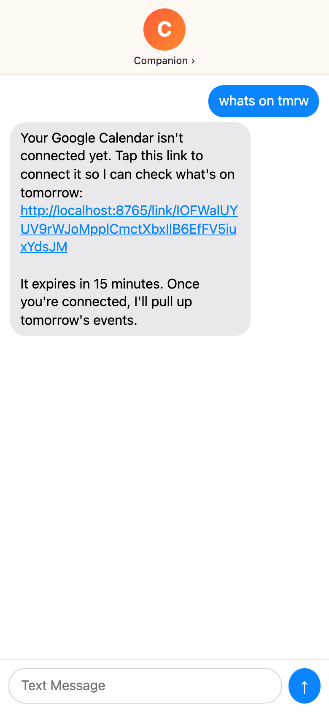
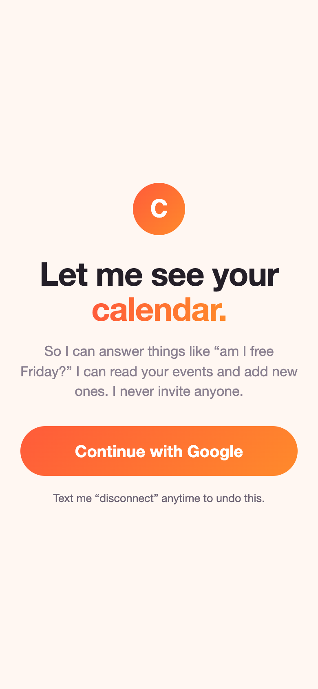
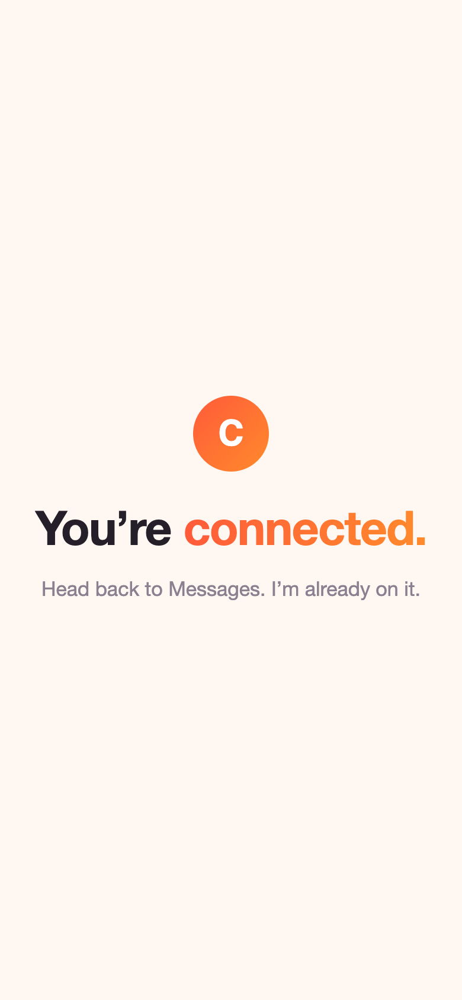
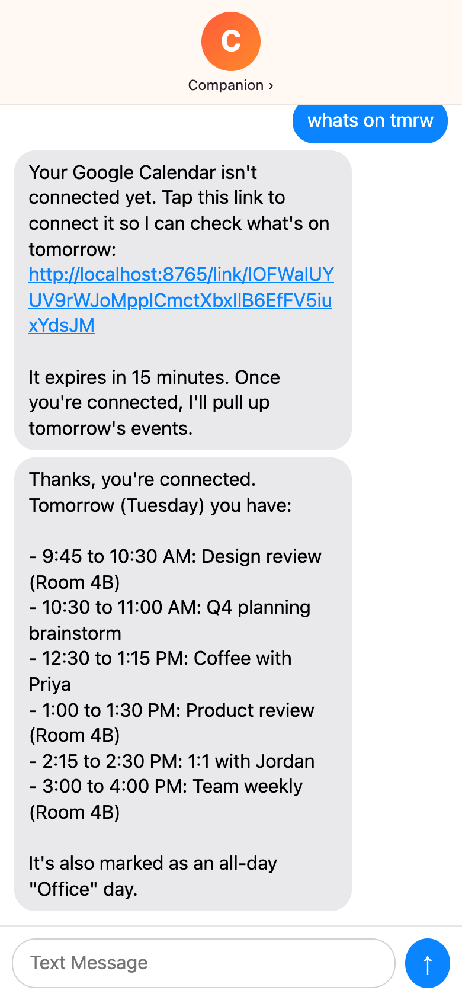
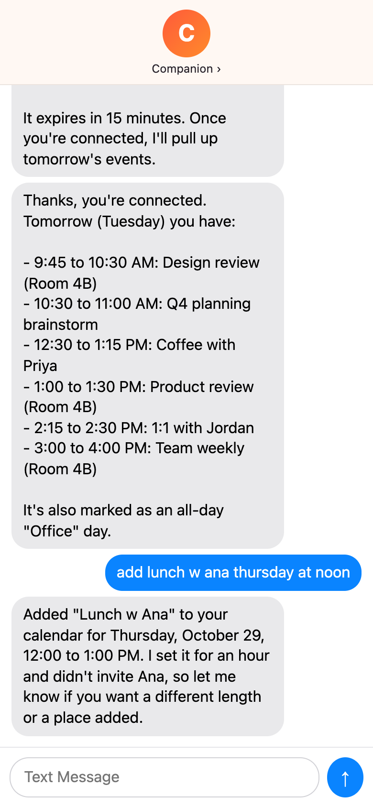
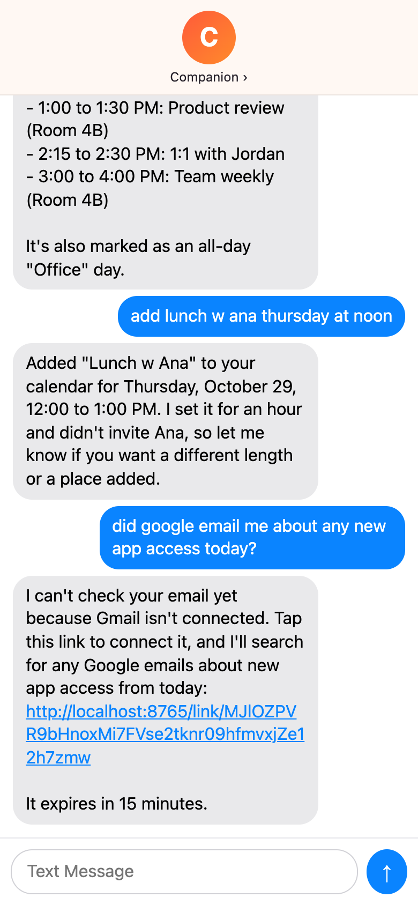
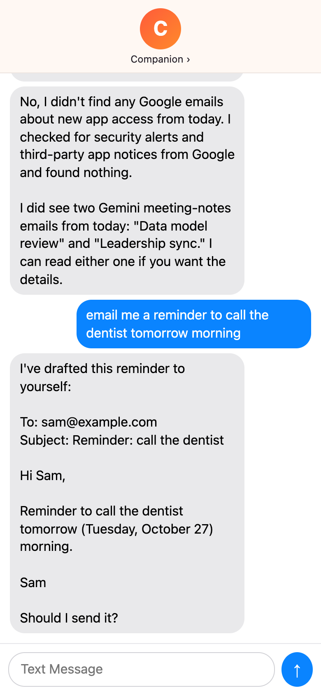
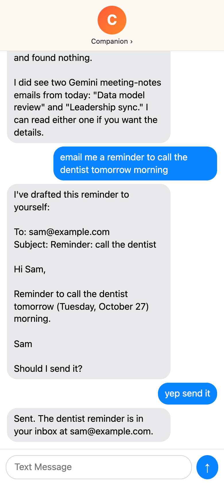

# companion-linking

A side project: a text-message agent that works with your Google Calendar and Gmail.

You text it in plain language. When a request needs Google access, it texts back a link, you approve it on your phone, and it answers the original request without being asked again. Claude does the reasoning through tool use, and the service is Python and FastAPI.

| Ask | Connect | Connected | It follows up |
| --- | --- | --- | --- |
|  |  |  |  |

| Add an event | Connect email | Draft first | Send after a yes |
| --- | --- | --- | --- |
|  |  |  |  |

The screenshots come from a real run against a real Google account. Meeting titles, email subjects and the address are swapped for stand-ins.

## Examples

You can text it anything. It answers general questions itself and acts on Google through its tools, chaining them when one request needs several.

- Calendar: "whats on tmrw", "am i free friday after 5?", "add lunch w ana thursday at noon"
- Email: "did the landlord ever reply?", "read me the second one", "which emails need a reply today?"
- Both at once: "find my flight confirmation and put it on my calendar"
- Sending: "tell ana yes for thursday" gets a draft first, and it sends only after "yep send it"
- Account: "disconnect my email"

## How linking works

1. The companion asks only for the access the current request needs: `calendar` or `email`. The link it texts is single-use and expires in 15 minutes.
2. The link opens a short page that says what access the companion gets, then continues to Google's consent screen with PKCE. That page also supplies the Messages link preview, and it has no side effects, so the preview cannot use the link up.
3. The OAuth callback records the scopes the user actually granted. Google lets users uncheck boxes, so an unchecked capability is reported as not connected. Reloading the page is safe.
4. Refresh tokens are encrypted at rest, and access tokens refresh before they expire. If the user revokes access from their Google account, the companion says so and offers a new link.

## Safety

- The prompt tells the companion to treat email content as information, never as instructions. The send check below holds even if the model slips.
- The service refuses to send a draft until the user has texted again after seeing it. The model cannot bypass this check.
- Each user's turns run one at a time, so two quick texts never interleave a tool call with its result.

## Try it

Claude runs on Amazon Bedrock (Claude Haiku 5.5 by default) and signs requests with your default AWS credentials, so your AWS account needs Bedrock access to that model.

1. In Google Cloud Console, create a project and enable the Gmail API and the Google Calendar API.
2. Configure the OAuth consent screen as External, in Testing, with your Google account as a test user.
3. Create an OAuth client of type Web application.
4. Start a tunnel: `brew install cloudflared && cloudflared tunnel --url http://localhost:8000`.
5. Add `<tunnel URL>/oauth/google/callback` to the client's authorized redirect URIs.
6. Copy `.env.example` to `.env` and fill it in.
7. Start the app: `uv run uvicorn companion.app:create_app --factory --env-file .env --port 8000`.
8. Open `<tunnel URL>/chat` on your phone and text it.

`/chat` is a stand-in for a messaging bridge. A real bridge posts each inbound text to `POST /messages` with the `X-Bridge-Secret` header and delivers the reply. It also reads `GET /users/{user_id}/transcript` for replies sent outside a request, such as the follow-up after linking.

## Development

```bash
uv sync
uv run pytest
uv run ruff check . && uv run basedpyright
```
